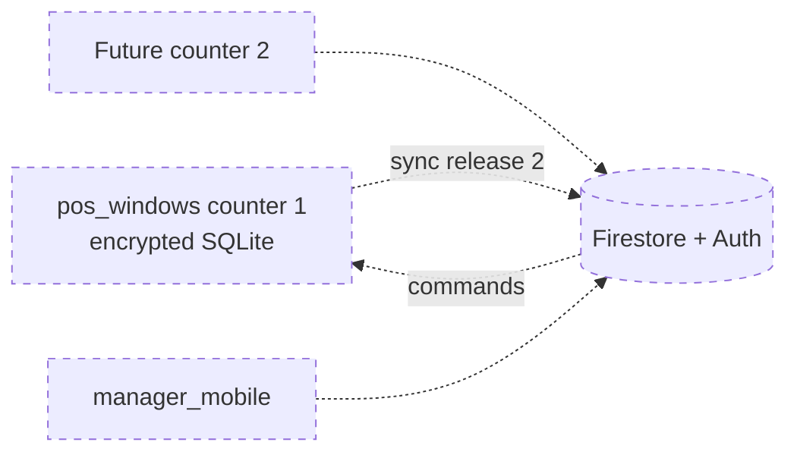

# System architecture
Status: draft for Gate 3, 2026-11-17

Purpose: the parts, who may talk to whom, and where logic and data live. Decisions: ADR-0001, 0002, 0003, 0004, 0008.

## Summary
Flutter/Dart monorepo. The counter app writes to a local encrypted SQLite database (Drift, WAL). A sync package pushes compact deltas to Cloud Firestore and pulls owner commands. Nothing exists yet.

## Parts
| Name | Kind | Purpose | Called by | Status |
|---|---|---|---|---|
| `pos_windows` | Flutter Windows app | Billing, stock, barcodes, returns, cash close | Cashier, owner | Planned (release 1) |
| `core_domain` | Dart package | Pricing, money, barcodes, permission matrix | All apps | Planned (release 1) |
| `sync_engine` | Dart package | Outbox, Firestore push/pull | Counter apps | Planned (release 2) |
| `manager_mobile` | Flutter Android/iOS | Owner analytics and commands | Owner | Planned (release 2) |
| `firebase/` | Rules and optional functions | Store isolation, claims | Firebase | Planned (release 2) |

## Boundary rules
1. Apps read and write only their own local database. Only `sync_engine` imports Firestore (ADR-0004).
2. Business rules (pricing, serials, returns, tax rounding) live only in `core_domain`.
3. `storeId` and `role` come from the verified token, never from a client request (ADR-0001, 0002).
4. Cost columns are never selected in Sales Mode; the local database is encrypted (ADR-0003).
5. Money is integer paise (ADR-0007).

## Diagram

## Main request path (a sale)
Scan barcode, then `core_domain` prices the cart, then the sale, sale items, daybook row and outbox row commit in one local transaction, then the article becomes SOLD. Sync happens later.

## Deployment
Release 1: the app on the shop's Windows laptop with a daily local backup (ADR-0015). Cloud: Firebase project, created in release 2. **Unverified:** Firebase pricing and plan limits.
